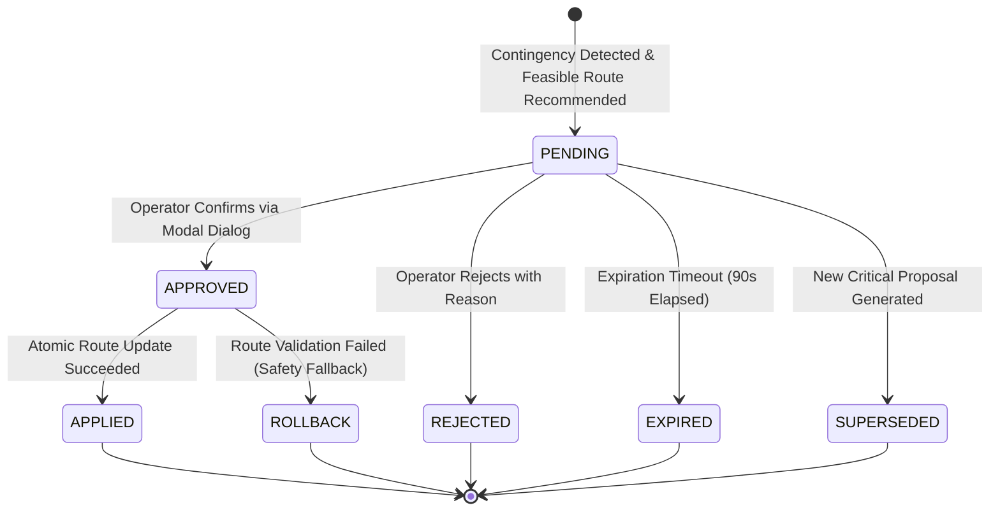

# STEP 10: Closed-Loop Mission Re-Routing & GCS Pilot Confirmation

## Executive Summary

Step 10 implements a production-quality, human-in-the-loop (HITL) **Closed-Loop Mission Re-Routing & GCS Pilot Confirmation Subsystem** for the **DRDO Mission-Aware Hybrid-Electric UAV Digital Twin (`DRDO-UAV-EngineTwin`)**.

In previous milestones (Steps 7–9), the Digital Twin gained the capability to detect platform contingencies, evaluate multi-criteria route trade-offs, and project forward flight risk envelopes using faster-than-real-time predictive Monte Carlo simulations. However, in mission-critical aerospace applications, autonomous systems must **never** mutate an active aircraft flight plan without explicit, authenticated human operator authorization.

Step 10 completes the operational decision-support loop:
```
LIVE SIMULATION STATE
        │
        ▼
CONTINGENCY DETECTION (Step 7/8)
        │
        ▼
ROUTE RECOMMENDATION (Step 8/9)
        │
        ▼
PROPOSAL GENERATION & DEDUPLICATION (Step 10)
        │
        ▼
GCS PILOT NOTIFICATION & REVIEW (Tab 8)
        │
        ▼
OPERATOR CONFIRMATION / REJECTION (Modal Auth)
        │
        ▼
ATOMIC SIMULATED ROUTE UPDATE (Spatial Nav Engine)
        │
        ▼
IMMUTABLE AUDIT TRAIL LOGGING
```

> [!IMPORTANT]
> **Engineering Simulation Boundary**: This is an engineering simulation and decision-support prototype. It does **not** implement real aircraft flight control, hardware avionics bus interfaces (e.g., ARINC 429, MIL-STD-1553), or real autopilot actuation. All route commands and updates remain strictly within the simulated environment.

---

## System Architecture & File Tree

```
DRDO-UAV-EngineTwin/
├── configs/
│   ├── mission_rerouting_config.json      # [NEW] Expiry, suppression, auto-expire & safeguard thresholds
│   ├── fast_forward_config.json           # Step 9 Monte Carlo distributions & safety policies
│   ├── decision_engine_config.json       # Step 8 contingency triggers & alternate bases
│   └── mission_config.json               # 7-waypoint active flight route
├── mission/
│   ├── __init__.py                       # [UPDATED] Step 10 classes and enums exported
│   ├── mission_rerouting_manager.py      # [NEW] Proposal state machine, 10 safeguards, deduplication & audit
│   ├── mission_state.py                  # [UPDATED] active_route_id added to MissionNavigationState
│   ├── navigation.py                     # [UPDATED] apply_new_route with atomic rollback & route_version
│   ├── predictive_risk_analyzer.py       # Step 9 risk analyzer
│   ├── trajectory_optimizer.py           # Step 8 trajectory optimizer
│   ├── decision_engine.py                # Step 8 AI decision engine
│   └── reliability_engine.py             # Step 7 reliability scoring
├── digital_twin/
│   └── uav_digital_twin.py               # [UPDATED] Integrated rerouting_manager, evaluation hook & flat telemetry
├── engine_service.py                     # [UPDATED] 6 REST endpoints for route, proposals, approval, rejection, audit
├── dashboard/
│   ├── index.html                        # [UPDATED] Avionics badge, Tab 8 UI layout & pilot confirmation modal
│   └── app.js                            # [UPDATED] Real-time 20 Hz telemetry parsing, multi-route canvas & REST API hooks
├── tests/
│   ├── test_mission_rerouting_manager.py # [NEW] 6/6 Proposal creation & lifecycle tests
│   ├── test_operator_confirmation.py     # [NEW] 7/7 Operator decision & safety safeguard tests
│   ├── test_mission_rerouting_api.py     # [NEW] 6/6 FastAPI REST endpoint tests
│   └── test_mission_rerouting_integration.py # [NEW] 2/2 Closed-loop end-to-end integration & rollback tests
├── test_mission_rerouting_manager.py     # Root test proxy
├── test_operator_confirmation.py         # Root test proxy
├── test_mission_rerouting_api.py         # Root test proxy
├── test_mission_rerouting_integration.py # Root test proxy
├── run_all_tests.py                      # [UPDATED] Master test runner with 22 total suites
└── docs/
    └── STEP10_CLOSED_LOOP_MISSION_REROUTING.md # [NEW] Comprehensive Step 10 technical dossier
```

---

## 1. Ten Critical Safety Safeguards

To prevent hazardous flight deviations, mode confusion, or unauthorized flight plan modifications, the subsystem enforces ten strict safety safeguards:

| # | Safeguard Name | Enforcement Mechanism |
|---|----------------|-----------------------|
| 1 | **Human-in-the-Loop Authority Lock** | AI trajectory suggestions **never** modify the active route automatically. Every update requires explicit operator approval (`POST /api/mission/proposals/{id}/approve`). |
| 2 | **Deduplication & Anti-Thrashing** | Identical contingency recommendations within a configurable suppression window (default `10.0 s`) are suppressed, preventing operator alert fatigue. |
| 3 | **Automatic Proposal Expiration** | Proposals transition to `EXPIRED` if the operator does not act within `proposal_validity_window_s` (default `90.0 s`), preventing stale divert routes from being activated. |
| 4 | **Pre-Proposal Feasibility Check** | Only candidates validated as physically feasible by the trajectory optimizer and risk analyzer can be elevated to a pending proposal. |
| 5 | **Digital Twin Data Quality Gate** | If the Digital Twin quality status is `INVALID` (e.g., NaN corruption, severe sensor dropout), proposal creation and operator approvals are strictly blocked. |
| 6 | **State Machine Integrity Enforcement** | Terminal states (`APPROVED`, `REJECTED`, `EXPIRED`, `SUPERSEDED`) are immutable. Only proposals in `PENDING` state can be approved or rejected. |
| 7 | **Atomic Rollback & State Validation** | In `SpatialNavigationEngine.apply_new_route()`, a complete internal state backup is created before applying new waypoints. If validation fails, full rollback occurs instantly. |
| 8 | **Re-Entrant Concurrency Locks** | All proposal mutations, queries, and route updates are protected by `threading.RLock()`, guaranteeing thread-safety across concurrent FastAPI and 20 Hz simulation threads. |
| 9 | **Immutable Chronological Audit Trail** | Every lifecycle event (`CREATED`, `APPROVED`, `REJECTED`, `EXPIRED`, `APPLIED`, `ROLLBACK`) is appended to a tamper-evident in-memory log with monotonic timestamps. |
| 10 | **Operator Authentication Attribution** | Approvals and rejections record the authenticated operator identifier (e.g., `PILOT-GCS-01`), timestamp, and explicit operational rationale. |

---

## 2. Proposal Lifecycle & State Machine



### Lifecycle States (`ProposalStatus`):
- `PENDING`: Proposal is awaiting Ground Control Station operator review.
- `APPROVED`: Pilot has confirmed acceptance; ready for simulation route insertion.
- `REJECTED`: Pilot has declined the proposed route change with recorded justification.
- `EXPIRED`: Proposal validity window lapsed without operator confirmation.
- `SUPERSEDED`: A newer, higher-priority contingency replaced an unconfirmed pending proposal.
- `APPLIED`: New route successfully committed into `SpatialNavigationEngine` with incremented `route_version`.

---

## 3. Spatial Navigation Engine Closed-Loop Extension (`mission/navigation.py`)

The navigation engine was extended to support atomic, rollback-safe dynamic route updates while preserving flight continuity:

```python
def apply_new_route(self, new_waypoints: List[Waypoint], route_id: str,
                    current_position: Optional[GeographicPosition] = None) -> bool:
    """
    Atomically updates active route in the navigation engine with full rollback safety.
    """
    # 1. State Backup for Rollback Safety
    backup_waypoints = list(self.waypoints)
    backup_index = self.current_waypoint_index
    backup_completed_m = self.total_distance_completed_m
    backup_route_id = self.active_route_id
    backup_version = self.route_version
    
    try:
        # 2. Validation
        if not new_waypoints or len(new_waypoints) < 1:
            raise ValueError("New route must contain at least 1 waypoint.")
            
        # 3. Apply New Flight Plan
        self.waypoints = list(new_waypoints)
        self.active_route_id = route_id
        self.route_version += 1
        self.current_waypoint_index = 0
        self.total_planned_route_distance_m = self._calculate_total_route_distance(self.waypoints)
        
        # 4. Continuity & Distance Initialization
        ...
        return True
    except Exception as e:
        # Full Rollback on Failure
        self.waypoints = backup_waypoints
        self.current_waypoint_index = backup_index
        self.total_distance_completed_m = backup_completed_m
        self.active_route_id = backup_route_id
        self.route_version = backup_version
        return False
```

---

## 4. REST API Endpoint Reference (`engine_service.py`)

The FastAPI service exposes six dedicated endpoints for human-in-the-loop mission management:

### 1. `GET /api/mission/route`
Returns the currently active simulated flight route, version number, active waypoint, and complete waypoint list.

### 2. `GET /api/mission/proposals`
Returns all historical and pending route proposals.

### 3. `GET /api/mission/proposals/pending`
Returns the currently active `PENDING` proposal requiring pilot attention (or `null`).

### 4. `POST /api/mission/proposals/{proposal_id}/approve`
Pilot approval endpoint. Validates proposal state, atomic updates navigation engine, and logs audit event.
- **Request Body**:
```json
{
  "operator_id": "PILOT-GCS-01",
  "reason": "Engine thermal degradation confirmed; diverting to Baramati alternate airfield."
}
```

### 5. `POST /api/mission/proposals/{proposal_id}/reject`
Pilot rejection endpoint. Transitions proposal to `REJECTED`, leaves active flight route unchanged, and logs audit event.
- **Request Body**:
```json
{
  "operator_id": "PILOT-GCS-01",
  "reason": "Secondary sensor reading indicates false alarm; continuing planned mission."
}
```

### 6. `GET /api/mission/audit`
Returns the complete chronological audit log of all route modification events.

---

## 5. Ground Control Station Operator Interface (Tab 8)

The browser dashboard (`dashboard/index.html` and `dashboard/app.js`) incorporates a dedicated cockpit workflow:

### A. Avionics Status Bar Badge
- Located on the top telemetry tape: `#badge-reroute-status`.
- `ROUTE STABLE` (Green): Nominal flight, active route unchanged.
- `PILOT ACTION REQUIRED` (Pulsing Amber): A route modification proposal is pending pilot review.
- `ROUTE UPDATED (v2)` (Blue): Route update committed and actively being tracked.

### B. Tab 8: Closed-Loop Re-Routing & Pilot Confirmation
1. **Section A: Active Route Telemetry Card**: Displays Active Route ID, Version, Target Waypoint, Distance Remaining, and Completed Progress.
2. **Section B: Proposed Route Comparison Matrix**: Side-by-side metric comparison between the Active Route and Candidate Proposed Route (Distance, Flight Time, Fuel, Battery, Risk).
3. **Section C: Operator Decision Card**: Displays triggering contingency, AI rationale, and expiration countdown. Provides `[ APPROVE & RE-ROUTE ]` and `[ REJECT PROPOSAL ]` buttons.
4. **Section D: Multi-Route Canvas Overlay**: 2D Mission Map draws active flight route in cyan and proposed diversion route in dashed amber with target marker.
5. **Section E: Immutable Audit Trail Table**: Real-time table displaying timestamp, event type, proposal ID, operator ID, and details.

### C. Modal Pilot Confirmation Dialog (`#modal-confirm-reroute`)
Clicking `[ APPROVE & RE-ROUTE ]` opens an aerospace confirmation modal requiring deliberate pilot confirmation before executing the HTTP POST request.

---

## 6. Verification & Test Suite Summary

Four dedicated test suites verify the complete operational integrity of Step 10:

| Test Suite | Purpose | Tests | Status |
|---|---|:---:|:---:|
| `test_mission_rerouting_manager.py` | Proposal models, creation, deduplication, auto-expiration, and config validation | 6 / 6 | **PASS** |
| `test_operator_confirmation.py` | Operator approval, rejection, state transitions, and 10 safety safeguards | 7 / 7 | **PASS** |
| `test_mission_rerouting_api.py` | FastAPI test client testing all 6 REST endpoints and HTTP responses | 6 / 6 | **PASS** |
| `test_mission_rerouting_integration.py` | Closed-loop integration: contingency trigger -> proposal -> approve -> navigation update & rollback | 2 / 2 | **PASS** |
| **Consolidated Step 10 Total** | **Complete Closed-Loop Subsystem Verification** | **21 / 21** | **PASS** |
